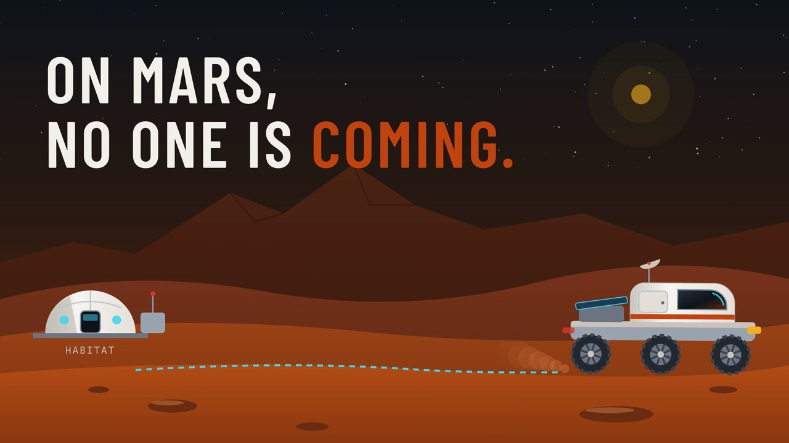

# LIFELINE

**Never go farther than you can walk home.**

LIFELINE is a Marswalk planner for the boxwork ridges of Mount Sharp in Gale Crater. It plans a crew excursion to three science stops and checks, at every minute and every place on the route, that the astronauts can still get home if the rover or a suit fails.

Team **Six Seven**, NASA Space Apps Challenge 2026, Nablus local event.
Challenge: *Interplanetary Survival Guide: Martian Map*.

## Start here

| | What | Open |
|---|---|---|
| ▶️ | **Video (2 min 12 s)**: the problem and the tool, shown in action | [Watch in the browser](https://faressalameh22.github.io/lifeline-marswalk/video/LIFELINE-video.mp4) · [file in this repo](video/LIFELINE-video.mp4) |
| 🌐 | **Live website**: the planner itself, no login, works on phone, tablet and laptop | https://faressalameh22.github.io/lifeline-marswalk/ |
| 🎬 | **Intro slides (7 slides, 1 minute)**: shown live before the video | [PDF](https://faressalameh22.github.io/lifeline-marswalk/slides/LIFELINE-intro.pdf) |
| 📄 | **Submission slides (7 slides)**: explain the whole project without a presenter | [PDF](https://faressalameh22.github.io/lifeline-marswalk/slides/LIFELINE-submission.pdf) |
| 💬 | **Detailed slides**: backup for the judges' questions | [PDF](https://faressalameh22.github.io/lifeline-marswalk/slides/LIFELINE-slides.pdf) |
| 📝 | **Submission text**: summary, data, references, use of AI | [SUBMISSION.md](SUBMISSION.md) |

[](https://faressalameh22.github.io/lifeline-marswalk/video/LIFELINE-video.mp4)

*Click the picture to play the video.*

## Try it in four steps

1. Drag the **EVA time** slider. The green safe zone shrinks toward the habitat as the suits run down.
2. Press **Rover fails**. LIFELINE draws the walk home and says how many minutes are left in reserve.
3. Press **Running late**. The gate at stop A sees too little margin for B and switches to plan B (skip B). Press it twice more (+45 min) and the gate sends the crew home (plan C).
4. Drag stop **C** far away. The verdict turns to **NO-GO**, and the *Why NO-GO* panel lists the changes that would make it safe.

Press **3D** at the top to see the real HRSC terrain in 3D (heights exaggerated three times), lit by a low afternoon sun with shadows under a dusty sky. *Surface: Realistic Mars* (default) colours it from height and slope: dust on gentle ground, dark banded rock on steep slopes, pale ridge tops, with ripples and pebbles up close. The shape is real data; the colours and small detail are illustrative, generated by code, not a photo. *Safety Overlay* shows the 2D map's margin colours on the terrain instead. The 3D view adds what the flat map cannot show well: a **safety fence**, a translucent wall along the edge of the ground the crew could still walk home from if the rover failed right now, which shrinks as the time slider moves; the route as a raised line with pins for H, A, B, C and the crew; **steep slopes** (amber over 15°, red above the slope limit); an **elevation profile** along the route with total climb and descent; a height slider (×1 to ×6) and ready views (Overview, Crew view, Top). It is a view only: stops are dragged on the 2D map and the 3D view follows live. Pinch or scroll to zoom toward a spot (down to about 1 km, the limit of the 30 m terrain data), drag with one finger to tilt and look at the ridges from the side, and use two fingers to pan.

## The idea

On the Moon, Apollo crews followed one rule: never drive farther from the lunar module than you can walk back if the rover fails. They also had a second limit: if a backpack failed, its emergency oxygen (about 0.95 h) had to last the ride home at 10 km/h. LIFELINE draws both limits on a real Mars map and adds a third one, the time an astronaut can stay in the suit.

## The mission

| Point | Latitude | Longitude | What it is |
|---|---|---|---|
| Habitat | −4.73384 | 137.40960 | Curiosity's position on sol 3038, flat ground (0.6° along the rover track) |
| Stop A, Altadena | −4.79985 | 137.38354 | Curiosity drill site, sol 4564, edge of the boxwork |
| Stop B, Monte Grande | −4.80784 | 137.38104 | Curiosity drill sites in a hollow (Valle de la Luna) and on the ridge beside it (Nevado Sajama) |
| Stop C | −4.80640 | 137.38150 | New site: a hollow inside the boxwork that Curiosity never reached; its route passes about 60 m away (57 m on sols 4810 to 4813; 90 m up to sol 4687) |

The crew visits A, then B, then C, then drives home. At each stop a gate checks the margin for the rest of the plan and drops a stop or sends the crew home when it falls under 30 min. With the default values the full plan fits: home by T+2:57.

## How the model works

```
walk_speed(cell)  = flat_speed × e^(−0.045·slope°) × sand_factor × load_factor     impassable above the slope limit
walk_home(cell)   = fastest walking time to the habitat over the terrain           (Dijkstra, 8 directions)
reserve(t)        = min(oxygen, cooling water) − Σ activity_rate × minutes          drive 0.67 · work 1.00 · walk 1.14
walk-back margin  = reserve(t) ÷ walk_rate − (1 + pad) × walk_home                  if the rover fails
ride-back margin  = emergency_O2 − (1 + pad) × ride_home at emergency speed         if the suit fails
time limit        = the whole plan ends inside the max time in suit
GO                = all three hold along the whole plan
```

Decision gates at each stop: if the margin ahead drops below the gate (30 min by default) or the plan would overrun the suit time limit, LIFELINE switches to plan B (skip the lowest-science stop), then plan C (go home). Plan D covers suit failure and solar storms (ride home, or walk to the nearest terrain shelter).

Crises in the demo: rover failure, suit failure, injured crew member, solar storm, and running late. They can be combined.

## Data

| Layer | Source |
|---|---|
| Terrain | Persaud, Putri & Muller (2021), *30-m HRSC DTM Mosaic of Gale Crater, Mars*, Zenodo, [doi:10.5281/zenodo.5808354](https://doi.org/10.5281/zenodo.5808354), CC BY 4.0. HRSC flies on ESA's Mars Express. |
| Curiosity track and stops A, B | NASA/JPL MMGIS `MSL_waypoints.json`, the data behind NASA's [Where is Curiosity?](https://mars.nasa.gov/maps/location/?mission=Curiosity) map |
| Surface radiation | Hassler et al. (2014), *Science* 343 (6169), [doi:10.1126/science.1244797](https://doi.org/10.1126/science.1244797), [NTRS 20180007641](https://ntrs.nasa.gov/citations/20180007641): 0.64 ± 0.12 mSv/day dose equivalent measured by Curiosity's RAD at Gale Crater (shown for context, not used in the margins). A 2013 press release quoted 0.67 mSv/day for a shorter period; we use the published value. |
| Walk-back and ride-back limits, activity rates, 20% pad, rover speeds, 0.95 h emergency oxygen, 3.1 km radius | P. Benjamin, *Apollo 15 EVA Capability and Constraints Envelopes*, Bellcomm memorandum B70 10028 (Case 320), 13 Oct 1970, NASA-CR-111182 (N79-73020): p. 1 items 5–10 (700/1050/1200 BTU/h, 20% pad, 8 and 10 km/h, 0.95 h), p. 2 (3.1 km at 3.3 km/h). Not in NTRS; first published in NASA's Apollo Lunar Surface Journal, whose link no longer works: [copy kept in this repo](data/refs/NASA-CR-111182_Apollo15_EVA_Capability_and_Constraints_Envelopes_1970.pdf), [Internet Archive copy of the NASA original](https://web.archive.org/web/2019/https://www.hq.nasa.gov/alsj/19790073512_1979073512.pdf). The memo pads the walk back only; LIFELINE also pads the ride back (more cautious). |
| Walking speed 2 km/h, suit oxygen and cooling water 8 h, nominal EVA 6 h | NASA, *xEVA System Concept of Operations*, EVA-EXP-0042 Rev. B, Oct 2020 ([nasa.gov PDF](https://www.nasa.gov/wp-content/uploads/2017/02/eva-exp-0042_xeva_system_con_ops_rev_b_final_dtd_10192020_ref_doc.pdf)): walking pace ~2 km/h on level regolith (p. 40); EVAs of up to 8 h, nominal 6 ± 2 h (pp. 29, 36). Artemis (Moon) planning values; no Mars suit figures exist yet. |
| Daylight window | Curiosity REMS sunrise and sunset for sols 4564 to 4687 (same feed as above): the walk must start after 05:52 and end before 17:22 local mean solar time |
| Boxwork science | NASA Curiosity mission blog posts, 2025 |
| Weather (REMS) | Curiosity REMS daily air temperature, pressure and sky, sols 4564 to 4687 (8 Jun to 12 Oct 2025, drill site A to drill site B), from NASA's MSL weather feed `mars.nasa.gov/rss/api/?feed=weather&category=msl&feedtype=json` (values by Centro de Astrobiología; outreach product, science data are in the PDS). 123 sols: air −82 to −5 °C, pressure 679 to 782 Pa. Stored unchanged in `data/rems-weather.js` |
| Stop photo A | Curiosity Mastcam (left), sol 4564, 8 Jun 2025, raw image `4564ML1077420021801947E01` (Altadena drill hole). Credit NASA/JPL-Caltech/MSSS. From NASA's [raw image archive](https://mars.nasa.gov/msl/multimedia/raw-images/) |
| Stop photo B | Curiosity Front Hazcam (left), sol 4687, 12 Oct 2025, raw image `FLB_813578617EDR_F1191722FHAZ00302M`: the "Valle de la Luna" block in the "Monte Grande" hollow, drilled on 18–19 Oct 2025 (NASA's own caption for its sol 4687 Front Hazcam image, [Curiosity Blog, sols 4689–4694](https://science.nasa.gov/blog/curiosity-blog-sols-4689-4694-drill-in-the-boxwork-unit-is-go/)). Credit NASA/JPL-Caltech |
| Stop view C (orbital) | MRO HiRISE `ESP_087149_1750` (28 Feb 2025), RED browse product (about 3 m/pixel), crop of 240 x 240 pixels (about 710 m) centred on stop C using the label's equirectangular projection. Credit NASA/JPL-Caltech/University of Arizona. No ground image of stop C exists |

Not yet connected: THEMIS thermal (sand). REMS weather is shown for context in the Environment panel; it does not change the margins.

Stop images are stored in `data/img/` (NASA images are public domain).

The terrain slice was read directly from the Zenodo GeoTIFF with HTTP range requests (the file is uncompressed float32, one row per strip), then stored in `data/terrain.js` at 0.2 m precision.

## Validation

Run `node tests/run-tests.js`. The same ten checks run live in the page's Validation panel.

Two more test scripts back the numbers and the page itself:

- `node tests/audit-numbers.js` recomputes every number quoted in this README, the submission text and the slides (crisis table, running-late table, sensitivity) from the model.
- `node tests/verify-raw-data.mjs` checks the raw data against the original sources: every terrain cell against the Zenodo GeoTIFF, and the habitat and stops against NASA's current Curiosity waypoint file. Results and the stop C HiRISE check are in [`docs/verification/`](docs/verification/README.md).
- `node tests/touch-3d.mjs` pinches, tilts and resets the 3D view with real touch events on a phone-sized screen.
- `node tests/edge-browser.mjs` (serve the folder on port 8790 first) drives the real page in headless Chrome through every crisis combination, repeated delays, out-of-range inputs and dragged stops, and fails on any console error, on "NaN", "undefined" or "Infinity" in the page, or on a verdict that differs from an independent run of the model.

| Check | Result |
|---|---|
| Path finder, straight line on flat ground | exact (72.0 min vs 72.0 min) |
| Path finder, any direction | worst overestimate 8.2%, the theoretical bound for an 8-direction grid, always on the safe side |
| **Reproduces Apollo's 3.1 km walking radius** | 3.12 km with Apollo inputs |
| **Terrain matches Curiosity's own altitudes** | 885 waypoints, RMSE 11.7 m across 823 m of relief |
| Rover failure at every minute of the plan | 178 simulated failures (every minute, T+0:00 to T+2:57), worst case 32 min spare |
| Suit failure at every minute | worst case 15 min of emergency oxygen left on arrival |
| Plan fits the time-in-suit limit and daylight | 2 h 57 against a 6 h EVA; out 08:00, home 10:57, sunset 17:22 |
| Margin never grows while suits run down | holds |
| Walk home never shorter than a straight line | 0 violations in 35,139 cells |
| Running 30 min late stays safe | +30 min at stop A: gates switch to plan B (skip B), home by T+2:55, worst margin 34 min |

## Assumptions and what they cost

Walking speed (2 km/h), suit oxygen and cooling water (8 h) and the nominal EVA length (6 h) come from NASA's xEVA System Concept of Operations (EVA-EXP-0042, 2020). They are planning values for the Moon; no Mars suit figures exist yet. NASA suited treadmill tests show why a slow pace is right for Mars: a 10 km walk in simulated lunar gravity took 96 min (1.74 m/s), while in simulated Mars gravity subjects approached maximum effort at 1.5 m/s (Norcross et al., [NASA/TP-2009-214796](https://www.lpi.usra.edu/lunar/artemis/NorcrossEtAl_NASA-TP-2009-214796_EVA%20Walkback%20Test.pdf), 2009; [NASA/TP-2010-216115](https://www.lpi.usra.edu/lunar/artemis/NorcrossEtAl_NASA-TP-2010-216115_PlanetarySuitMetabolicCosts.pdf), 2010).

Still team choices, not sourced: 30 min at each stop, EVA start 08:00 local time, the slope slowdown term e^(−0.045·slope°), payload effect (−0.5% speed and +1% effort per kg), injured crew factor (half speed, +30% effort), storm warning time (30 min), the 30 min gate, the 25° slope limit and the terrain shelter rule (flat ground under 10° at the foot of a slope over 18°).

The sensitivity chart shows the values matter. With 20% less suit capacity (−44 min) or 20% slower walking (−31 min), today's plan becomes NO-GO. Every value is visible and editable, and its effect is shown immediately. Lowering the safety pad is never offered as a fix.

## Project layout

```
index.html            page, styles and markup
js/mission.js         habitat, stops, default assumptions
js/model.js           terrain, path finding, plans, gates, crises, validation (no DOM)
js/app.js             map drawing, panels, controls
js/view3d.js          optional 3D view (three.js 0.160.0 from jsDelivr, loaded only when 3D is pressed)
data/terrain.js       HRSC elevation slice
data/rover-track.js   Curiosity waypoints in the slice
tests/run-tests.js    headless validation run
video/                the team's 2-minute video (LIFELINE-video.mp4) and its poster frame
slides/               intro, submission and detailed decks (PDF + HTML source), speaker notes, Q&A prep
```

No build step and no server: open `index.html` or serve the folder.

## Use of AI

We used Claude (Anthropic) to research past winners and NASA sources, to design the walk-back model with us, to write the code, and to extract the terrain slice and rover waypoints. The team chose the problem, the site and the mission, reviewed the model and its assumptions, and is responsible for the result. No AI-generated images are used.

## License

Code: MIT (see `LICENSE`). Terrain data: CC BY 4.0, Persaud et al. (2021). NASA data are used under NASA's open data policy. This project is not endorsed by NASA.
