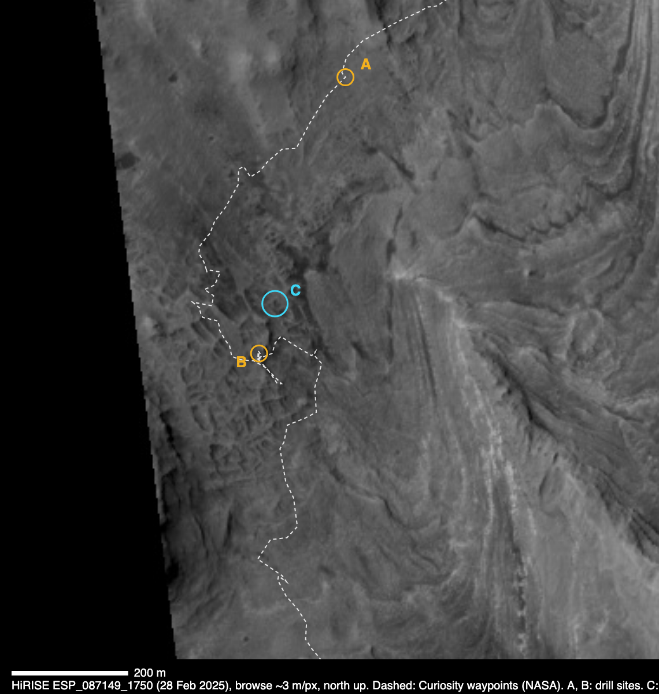
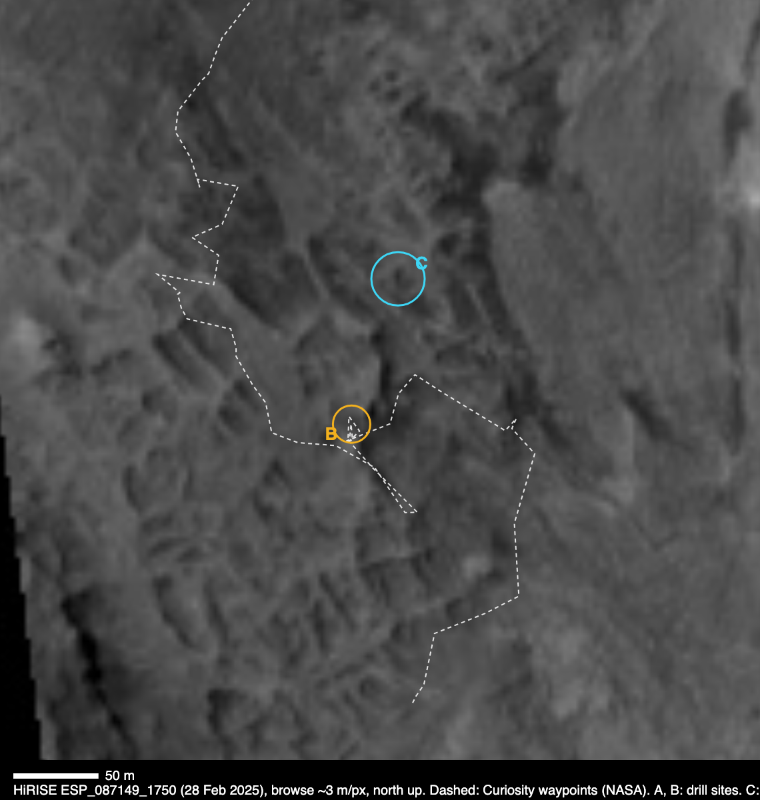

# Raw data verification

Checked on 14 Nov 2026 against the original public sources. Re-run with `node tests/verify-raw-data.mjs` (needs network).

## Terrain (`data/terrain.js`) against the Zenodo GeoTIFF

Source: Persaud, Putri & Muller (2021), 30-m HRSC DTM Mosaic of Gale Crater, Zenodo, doi:10.5281/zenodo.5808354.

- The file header read from Zenodo confirms the layout we rely on: 7584 x 10275 cells, 32-bit float, uncompressed, one row per strip, strip 0 at byte 82821, 30336 bytes per row, nodata −32768.
- The slice's georeferencing (west edge 137.354769207° E, north edge −4.714799379°, 59274.69752 m per degree, 30 m cells) matches the GeoTIFF tiepoint and pixel scale exactly.
- **All 35,139 cells** of the slice were compared with the original values (one range request for rows 3420 to 3640). No cell is nodata. Mean difference 0.048 m, maximum 0.100 m, which is the 0.1 m rounding of the 0.2 m storage step. No other difference.

## Habitat and stops against NASA's current Curiosity waypoint file

Source: `MSL_waypoints.json` from NASA's MMGIS, 1389 waypoints, sols 3 to 5073.

| Point | Result |
|---|---|
| Habitat | Waypoint of sol 3038, 0.3 m away |
| Stop A, Altadena | Waypoint of sol 4560 (site 116, drive 1944), 0.2 m away. The next waypoint is sol 4571, so the rover stood here on the drill sol 4564. The sol 4564 Front Hazcam image is named `...F1161944...` (site 116, drive 1944). |
| Stop B, Monte Grande | Waypoint of sol 4687 (site 119, drive 1722), 0.3 m away. The stop B image `FLB_813578617EDR_F1191722FHAZ00302M` was taken from this exact position (site 119, drive 1722). |
| Stop C | Never reached. 90 m from the rover's path up to sol 4687; since the drive of sols 4810 to 4813 the path passes 57 m away. The site text was corrected from "about 90 m" to "about 60 m". |
| `data/rover-track.js` | All 885 points are in the current file (within 0.5 m). |

## Stop C on HiRISE

Image: HiRISE `ESP_087149_1750` (28 Feb 2025), RED browse product (about 3 m per pixel), placed with the equirectangular projection from its PDS label. Curiosity waypoints and stops A, B, C drawn on top (`hirise-overlay.html` redraws it).

Reading: B, a Curiosity drill site in the boxwork, sits inside a network of polygonal cells bounded by lighter ridges. C lies about 90 m north of B in the same network, inside a dark cell bounded by ridges, which is the shape of a boxwork hollow. Smoother terrain without cells begins about 40 m east of C.

Limits: at 3 m per pixel individual ridges are only a few pixels wide, and the registration between the HiRISE map projection and the waypoint frame was not measured independently (it may be off by some metres to tens of metres). A full-resolution (0.25 m) look at the same image would settle the exact hollow.
